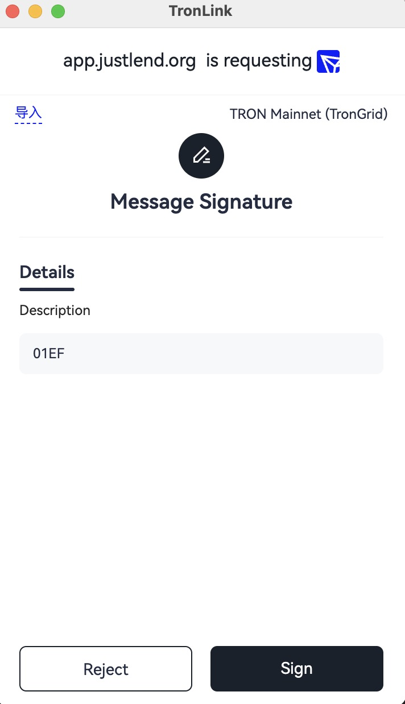

# Message Signature

## Overview

A DApp can ask users to sign a message for login verification. The signed message will be forwarded to the back-end to verify whether a user's login is legitimate.

> **Prerequisite:** The DApp connection has been authorized via `eth_requestAccounts` (see [Start Developing](getting-started.md#request-authorization)).

## Specification

### Example

```javascript
const tronweb = window.tron.tronWeb;
const message = "Sign in to Example DApp\nNonce: 8f3a2c"; // plain UTF-8 text
try {
  const signedString = await tronweb.trx.signMessageV2(message);
  // verify with the same string; returns the signer's base58 address
  const recovered = await tronweb.trx.verifyMessageV2(message, signedString);
  const ok = recovered === tronweb.defaultAddress.base58;
} catch (e) {}
```
### Parameters

Pass the message as a non-empty **string**. TronLink signs the UTF-8 bytes of that string with the TIP-191 prefix `"\x19TRON Signed Message:\n" + <byte length>`. A hex-looking string is **not** decoded: `"0x1234"` is signed as six text characters (bytes `30 78 31 32 33 34`), not as the two raw bytes `12 34`.

Through the TronLink-injected `tronWeb`, only strings are supported (TronLink extension 4.0.0 and later). TronWeb itself also accepts `Uint8Array` / `number[]` for raw bytes, but TronLink rejects those types, so a DApp cannot ask TronLink to sign arbitrary raw bytes with `signMessageV2`.

To verify, pass the **same string** to `verifyMessageV2`, as in the example above. It returns the recovered base58 address and does not throw on a mismatch — compare the address yourself.

See [TronWeb: Sign and Verify Message](https://tronweb.network/docu/docs/Sign%20and%20Verify%20Message/).

### Returns

If the user chooses to sign in the pop-up window, the DApp will get the signed hexadecimal string. For example:

```text
    0xb0e0b150b9b10dc348f25c7f38fc87f16e18c0d230d23946aac519a5ad9e45937f656012d33c09e9d9dec00b03fbb304e797f8991bb823dce676ac91e03a55991b
```

If an error occurs, the following information will be returned:

```text
    
    Uncaught (in promise) Invalid transaction provided
```

## Interaction

When “tronweb.trx.signMessageV2(message);” is executed, a pop-up window will show in the TronLink wallet asking the user to confirm, as shown below. The popup displays the message as text:



If the user chooses “Reject” in the pop-up window, an exception will be thrown, which the developer can catch for further processing.

## Errors

**Error shape:** On the TronLink-injected `tronWeb` (extension 4.0.0 and later), when the user rejects `trx.sign`, `trx.multiSign`, or `trx.signMessageV2`, the promise rejects with the **plain string** `'Confirmation declined by user'` — not an `Error` object, and without a numeric `code`. The `{ code: 4001, message: 'User rejected the request.' }` object is returned only by `window.tron.request(...)` methods such as `eth_requestAccounts`. Other failures (locked wallet, invalid payload, watch-only account) use other values — see [Handling rejections](../reference/error-code-map.md#handling-rejections). Do not automatically retry signing.

| Code | Meaning | Where it comes from | Retryable? |
| :---: | --- | --- | :---: |
| `'Confirmation declined by user'` (string) | User clicked **Reject** in the signing popup | `tronWeb.trx.signMessageV2(message)` | No — user declined |
| `'Invalid transaction provided'` (string) | Empty message, or signing failed inside the wallet | `signMessageV2(...)` | No — pass a non-empty string |
| `'Transaction integrity check failed'` (string) | Non-string message (e.g. `Uint8Array`) blocked by the wallet; returned after the user closes TronLink's warning popup. Extension 4.11.0 and earlier return `'Invalid transaction provided'` instead | `signMessageV2(...)` | No — pass a string |
| `'User has not unlocked wallet'` (string) | Wallet is locked, or the DApp was disconnected after authorization | `signMessageV2(...)` | Yes — after the user unlocks or reconnects |
| (thrown) | Provider not injected / wallet not authorized | `window.tron.tronWeb` undefined | No — connect first via `eth_requestAccounts` |

For cross-surface translation (DApp ↔ DeepLink ↔ MCP ↔ CLI) see the [Error Code Map](../reference/error-code-map.md).

