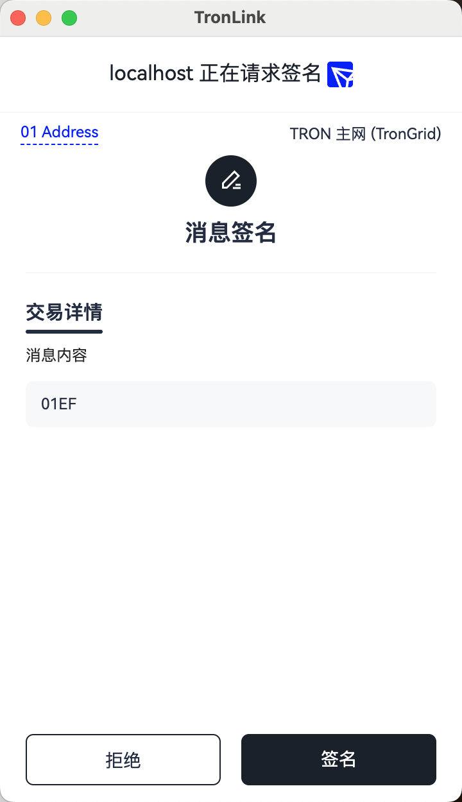

# 消息签名

## 简介

DApp 可以请求用户对消息签名，再将消息与签名转发给后端验签，以此验证用户登录。

> **前提条件：** 已通过 `eth_requestAccounts` 完成 DApp 连接授权（参见[开始开发](getting-started.md)）。

## 技术规范

### 代码示例

```javascript
const tronweb = window.tron.tronWeb;
const message = "Sign in to Example DApp\nNonce: 8f3a2c"; // 普通 UTF-8 文本
try {
  const signedString = await tronweb.trx.signMessageV2(message);
  // 用同一个字符串验签，返回签名者的 base58 地址
  const recovered = await tronweb.trx.verifyMessageV2(message, signedString);
  const ok = recovered === tronweb.defaultAddress.base58;
} catch (e) {}
```

### 参数

消息须为非空**字符串**。TronLink 对该字符串的 UTF-8 字节签名，并加上 TIP-191 前缀 `"\x19TRON Signed Message:\n" + <字节长度>`。外观类似 hex 的字符串**不会**被解码：`"0x1234"` 按六个文本字符（字节为 `30 78 31 32 33 34`）签名，而不是两个原始字节 `12 34`。

通过 TronLink 注入的 `tronWeb` 只支持字符串（TronLink 插件 4.0.0 起）。TronWeb 本身还接受 `Uint8Array` / `number[]` 来签原始字节，但 TronLink 会拒绝这些类型，因此 DApp 无法通过 `signMessageV2` 让 TronLink 对任意原始字节签名。

验签时把**同一个字符串**传给 `verifyMessageV2`（见上方示例）。它返回恢复出的 base58 地址，地址不匹配时不会抛错——需要自行比对。

参见 [TronWeb 消息签名与验签说明](https://tronweb.network/docu/docs/Sign%20and%20Verify%20Message/)。

### 返回值

如果用户在弹窗中选择签名, DApp 可以得到签名后的十六进制字符串, 比如：

```text
    0xb0e0b150b9b10dc348f25c7f38fc87f16e18c0d230d23946aac519a5ad9e45937f656012d33c09e9d9dec00b03fbb304e797f8991bb823dce676ac91e03a55991b
```

如果报错，则会返回如下信息：

```text
    Uncaught (in promise) Invalid transaction provided
```

## 交互流程

当代码执行到`await tronweb.trx.signMessageV2(message);`时，TronLink 钱包会提示弹窗，需要用户进行确认，如下图。弹窗以文本形式展示消息内容：



如果用户在弹窗中选择【拒绝】，则会抛出异常，开发者可捕获此异常进行业务处理。

## 错误码

**错误结构：** 在 TronLink 注入的 `tronWeb` 上（插件 4.0.0 起），用户拒绝 `trx.sign`、`trx.multiSign` 或 `trx.signMessageV2` 时，Promise 以**纯字符串** `'Confirmation declined by user'` reject——不是 `Error` 对象，也没有数字 `code`。`{ code: 4001, message: 'User rejected the request.' }` 对象只由 `window.tron.request(...)` 方法（如 `eth_requestAccounts`）返回。其他失败（钱包未解锁、载荷非法、观察钱包等）返回其他值——参见[处理拒签](../reference/error-code-map.md#handling-rejections)。不要自动重试签名。

| 码 | 含义 | 来源 | 可重试? |
| :---: | --- | --- | :---: |
| `'Confirmation declined by user'`（字符串） | 用户在签名弹窗里点【拒绝】 | `tronWeb.trx.signMessageV2(message)` | 否——用户拒绝 |
| `'Invalid transaction provided'`（字符串） | 消息为空，或钱包内部签名失败 | `signMessageV2(...)` | 否——传入非空字符串 |
| `'Transaction integrity check failed'`（字符串） | 非字符串消息（如 `Uint8Array`）被钱包拦截，在用户关闭 TronLink 警告弹窗后返回；插件 4.11.0 及更早返回 `'Invalid transaction provided'` | `signMessageV2(...)` | 否——传入字符串 |
| `'User has not unlocked wallet'`（字符串） | 钱包未解锁，或 DApp 授权后已断开连接 | `signMessageV2(...)` | 是——用户解锁或重新连接后 |
| (抛出) | provider 未注入 / 钱包未授权 | `window.tron.tronWeb` 未定义 | 否——先通过 `eth_requestAccounts` 连接 |

跨 surface 的码对照见[错误码对照表](../reference/error-code-map.md)。

