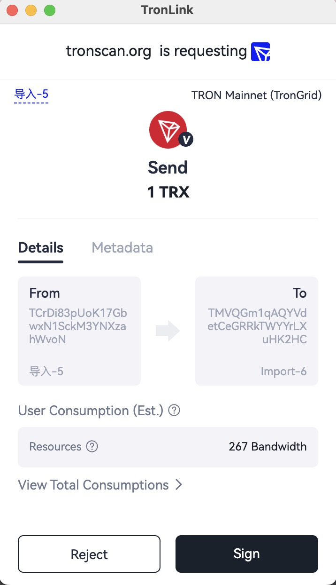

# General Transfer

## Overview

DApp requires users to initiate a TRX transfer.

> **Prerequisite:** The DApp connection has been authorized via `eth_requestAccounts` (see [Start Developing](getting-started.md#request-authorization)).

It takes 3 steps to initiate a transfer on the TRON network:

  1. Create a transfer transaction

  2. Sign the transaction

  3. Broadcast the signed transaction

In this process, Step 2 requires TronLink while both Step 1 and 3 happen on tronWeb.

## Specification

### Example

```javascript
const tronweb = window.tron.tronWeb;
const fromAddress = tronweb.defaultAddress.base58;
const toAddress = "TAHQdDiZajMMP26STUnfsiRMNyXdxAJakZ";
const tx = await tronweb.transactionBuilder.sendTrx(toAddress, 10, fromAddress); // Step 1
try {
  const signedTx = await tronweb.trx.sign(tx); // Step 2
  await tronweb.trx.sendRawTransaction(signedTx); // Step 3
} catch (e) {
  // error handling
}
```

When “await tronweb.trx.sign(tx);” is executed, a pop-up window will show in the TronLink wallet asking the user to confirm, as shown below: 



If the user chooses on “Reject” in the pop-up window, an exception will be thrown, which the developer can catch for further processing.

If the user chooses “Sign” in the pop-up window, the DApp receives and broadcasts the signed transaction.

## Errors

**Interface distinction:** Codes documented for `provider.request(...)`, such as `4001` for user rejection, are not a universal contract for `tronWeb.trx.sign`, `multiSign`, or `signMessageV2`. Catch signing exceptions; a numeric `code` may be absent. Confirm the error shape for the TronLink/TronWeb versions you support before classifying it. An unrecognized exception is not proof of user rejection. Do not automatically retry signing.

| Code | Meaning | Where it comes from | Retryable? |
| :---: | --- | --- | :---: |
| (thrown; version-dependent shape) | User clicked **Reject** in the signing popup | `tronWeb.trx.sign(tx)` | No — user declined |
| (thrown) | `Invalid address` / `Invalid amount` / etc. | `transactionBuilder.sendTrx(...)` before any wallet interaction | No — fix the input |
| `REVERT` / `OUT_OF_ENERGY` / `FAILED` | Broadcast succeeded but execution failed on-chain | `sendRawTransaction` result or `tronWeb.trx.getTransactionInfo(txid)` | **No — the tx is final; never auto-retry** |
| (network error) | TronGrid / RPC transient failure | `sendRawTransaction` HTTP layer | Yes — back off and retry |

For cross-surface translation (DApp ↔ DeepLink ↔ MCP ↔ CLI) see the [Error Code Map](../reference/error-code-map.md).
