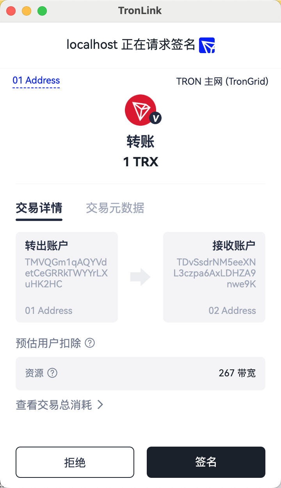

# 普通转账

## 简介

DApp 需要用户发起一笔 TRX 转账。

> **前提条件：** 已通过 `eth_requestAccounts` 完成 DApp 连接授权（参见[开始开发](getting-started.md)）。

波场网络上发起转账需要3个步骤：

  1. 构造转账交易

  2. 对交易进行签名

  3. 对签名后的交易进行广播

在这里，TronLink 介入的是第2步签名的部分，1, 3 两步需要开发者使用 tronWeb 完成

## 技术规范

### 代码示例

```javascript
const tronweb = window.tron.tronWeb;
const fromAddress = tronweb.defaultAddress.base58;
const toAddress = "TTSFjEG3Lu9WkHdp4JrWYhbGP6K1REqnGQ";
const tx = await tronweb.transactionBuilder.sendTrx(toAddress, 10, fromAddress); // 步骤1
try {
  const signedTx = await tronweb.trx.sign(tx); // 步骤2
  await tronweb.trx.sendRawTransaction(signedTx); // 步骤3
} catch (e) {
  // error handling
}
```

当代码执行到`await tronweb.trx.sign(tx);`时，TronLink钱包会提示弹窗，需要用户进行确认，如下图：



如果用户在弹窗中选择【拒绝】，则会抛出异常，开发者可捕获此异常进行业务处理。

如果用户在弹窗中选择【签名】，DApp 可以拿到签名后的交易，继续进行广播。

## 错误码

**错误结构：** 在 TronLink 注入的 `tronWeb` 上（插件 4.0.0 起），用户拒绝 `trx.sign`、`trx.multiSign` 或 `trx.signMessageV2` 时，Promise 以**纯字符串** `'Confirmation declined by user'` reject——不是 `Error` 对象，也没有数字 `code`。`{ code: 4001, message: 'User rejected the request.' }` 对象只由 `window.tron.request(...)` 方法（如 `eth_requestAccounts`）返回。其他失败（钱包未解锁、载荷非法、观察钱包等）返回其他值——参见[处理拒签](../reference/error-code-map.md#handling-rejections)。不要自动重试签名。

| 码 | 含义 | 来源 | 可重试? |
| :---: | --- | --- | :---: |
| `'Confirmation declined by user'`（字符串） | 用户在签名弹窗里点【拒绝】 | `tronWeb.trx.sign(tx)` | 否——用户拒绝 |
| (抛出) | `Invalid address` / `Invalid amount` 等 | `transactionBuilder.sendTrx(...)` 在钱包交互前 | 否——修参数 |
| `REVERT` / `OUT_OF_ENERGY` / `FAILED` | 广播成功但链上执行失败 | `sendRawTransaction` 返回或 `tronWeb.trx.getTransactionInfo(txid)` | **否——交易已 final,永远不要自动重试** |
| (network error) | TronGrid / RPC 抖动 | `sendRawTransaction` HTTP 层 | 是——退避后重试 |

跨 surface 的码对照(DApp ↔ DeepLink ↔ MCP ↔ CLI)见[错误码对照表](../reference/error-code-map.md)。

