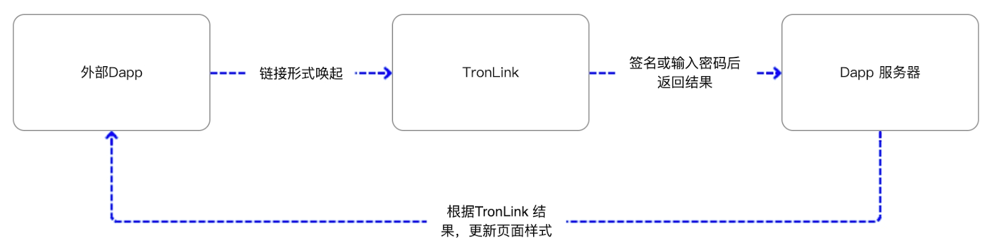

# DeepLink

DApp、H5 应用可以使用 DeepLink 方式拉起 TronLink App 进行打开钱包、登录、转账、签名交易、字符串签名、在钱包中打开 DApp 等操作。



<style>
img {
  max-width: 100%!important;
}
</style>

`param` 查询参数包含 URL 编码后的 JSON。每个示例链接都由其下方的请求对象编码而成。接入时请替换示例值，并重新生成链接。

```javascript
const buildDeepLink = (request) =>
  "tronlinkoutside://pull.activity?param=" + encodeURIComponent(JSON.stringify(request));
```

登录、转账和签名时，请使用自己的 DApp 地址、回调地址、目标 chainId 和新生成的 actionId。交易签名时，将 `data` 设为新构建交易的 JSON 字符串。示例交易的有效期已过。

## 打开钱包

使用 DeepLink 方式唤起钱包。可用版本：TronLink v4.10.0 起。

```html
<a href='tronlinkoutside://pull.activity?param=%7B%22action%22%3A%22open%22%2C%22protocol%22%3A%22TronLink%22%2C%22version%22%3A%221.0%22%7D'>Open Tronlink</a>
```

`param`（请求）：

```json
{
  "action": "open",
  "protocol": "TronLink",
  "version": "1.0"
}
```

## 打开 DApp

使用 DeepLink 方式唤起钱包，并在 DApp 浏览器中打开 DApp。可用版本：TronLink v4.10.0 起。

```html
<a href='tronlinkoutside://pull.activity?param=%7B%22url%22%3A%22https%3A%2F%2Fwww.tronlink.org%2F%22%2C%22action%22%3A%22open%22%2C%22protocol%22%3A%22TronLink%22%2C%22version%22%3A%221.0%22%7D'>Open DApp</a>
```

`param`（请求），`url` 为目标 DApp：

```json
{
  "url": "https://www.tronlink.org/",
  "action": "open",
  "protocol": "TronLink",
  "version": "1.0"
}
```

## 登录授权

使用 DeepLink 方式唤起钱包，并在钱包中选择获取钱包地址。可用版本：TronLink v4.11.0 起。

```html
<a href='tronlinkoutside://pull.activity?param=%7B%22url%22%3A%22https%3A%2F%2Fjustlend.org%2F%23%2Fhome%22%2C%22callbackUrl%22%3A%22https%3A%2F%2Fyour-backend.example.com%2Fapi%2Ftron%2Fv1%2Fcallback%22%2C%22dappIcon%22%3A%22https%3A%2F%2Fyour-dapp.example.com%2Ficon.png%22%2C%22dappName%22%3A%22Test%20demo%22%2C%22protocol%22%3A%22TronLink%22%2C%22version%22%3A%221.0%22%2C%22chainId%22%3A%220x2b6653dc%22%2C%22action%22%3A%22login%22%2C%22actionId%22%3A%22e5471a9c-b0f1-418b-8634-3de60d68a288%22%7D'>Login/Request Address</a>
```

`param`（请求）：

```json
{
  "url": "https://justlend.org/#/home",
  "callbackUrl": "https://your-backend.example.com/api/tron/v1/callback",
  "dappIcon": "https://your-dapp.example.com/icon.png",
  "dappName": "Test demo",
  "protocol": "TronLink",
  "version": "1.0",
  "chainId": "0x2b6653dc",
  "action": "login",
  "actionId": "e5471a9c-b0f1-418b-8634-3de60d68a288"
}
```

回调：

```json
{
  "actionId": "e5471a9c-b0f1-418b-8634-3de60d68a288",
  "address": "TSPrmJetAMo6S6RxMd4tswzeRCFVegBNig",
  "code": 0,
  "id": 1780812177,
  "message": "success"
}
```

## 转账

使用 DeepLink 方式唤起 TronLink，并发送转账数据，在钱包中转账并广播。可用版本：TronLink v4.11.0 起。

```html
<a href='tronlinkoutside://pull.activity?param=%7B%22url%22%3A%22https%3A%2F%2Fjustlend.org%2F%23%2Fhome%22%2C%22callbackUrl%22%3A%22https%3A%2F%2Fyour-backend.example.com%2Fapi%2Ftron%2Fv1%2Fcallback%22%2C%22dappIcon%22%3A%22https%3A%2F%2Fyour-dapp.example.com%2Ficon.png%22%2C%22dappName%22%3A%22Test%20demo%22%2C%22protocol%22%3A%22TronLink%22%2C%22version%22%3A%221.0%22%2C%22chainId%22%3A%220x2b6653dc%22%2C%22memo%22%3A%22Reward%22%2C%22from%22%3A%22TSPrmJetAMo6S6RxMd4tswzeRCFVegBNig%22%2C%22to%22%3A%22TXd9duqtcyyj4pBCKvXKNqmazxxDw5SdBa%22%2C%22loginAddress%22%3A%22TSPrmJetAMo6S6RxMd4tswzeRCFVegBNig%22%2C%22tokenId%22%3A%220%22%2C%22contract%22%3A%22%22%2C%22amount%22%3A%2220%22%2C%22action%22%3A%22transfer%22%2C%22actionId%22%3A%22408170fc-7919-4459-be5e-05a9d4b4065e%22%7D'>Transfer</a>
```

`param`（请求）：

```json
{
  "url": "https://justlend.org/#/home",
  "callbackUrl": "https://your-backend.example.com/api/tron/v1/callback",
  "dappIcon": "https://your-dapp.example.com/icon.png",
  "dappName": "Test demo",
  "protocol": "TronLink",
  "version": "1.0",
  "chainId": "0x2b6653dc",
  "memo": "Reward",
  "from": "TSPrmJetAMo6S6RxMd4tswzeRCFVegBNig",
  "to": "TXd9duqtcyyj4pBCKvXKNqmazxxDw5SdBa",
  "loginAddress": "TSPrmJetAMo6S6RxMd4tswzeRCFVegBNig",
  "tokenId": "0",
  "contract": "",
  "amount": "20",
  "action": "transfer",
  "actionId": "408170fc-7919-4459-be5e-05a9d4b4065e"
}
```

回调（`actionId` 与请求一致）：

```json
{
  "actionId": "408170fc-7919-4459-be5e-05a9d4b4065e",
  "code": 0,
  "id": 1142367107,
  "message": "success",
  "transactionHash": "e8ffe9b92c771e66999732b810bf2493be389464191040d8666a26dc449fa5f0"
}
```

## 交易签名

可用版本：TronLink v4.11.0 起。

```html
<a href='tronlinkoutside://pull.activity?param=%7B%22url%22%3A%22https%3A%2F%2Fjustlend.org%2F%23%2Fhome%22%2C%22callbackUrl%22%3A%22https%3A%2F%2Fyour-backend.example.com%2Fapi%2Ftron%2Fv1%2Fcallback%22%2C%22dappIcon%22%3A%22https%3A%2F%2Fyour-dapp.example.com%2Ficon.png%22%2C%22dappName%22%3A%22Test%20demo%22%2C%22protocol%22%3A%22TronLink%22%2C%22version%22%3A%221.0%22%2C%22chainId%22%3A%220x2b6653dc%22%2C%22action%22%3A%22sign%22%2C%22loginAddress%22%3A%22TSPrmJetAMo6S6RxMd4tswzeRCFVegBNig%22%2C%22method%22%3A%22transfer%28address%2Cuint256%29%22%2C%22signType%22%3A%22signTransaction%22%2C%22data%22%3A%22%7B%5C%22visible%5C%22%3Afalse%2C%5C%22txID%5C%22%3A%5C%22dcfaf2c2d75d91994f9a23623e905eaa7d74bc804fa5821640111ada3441376a%5C%22%2C%5C%22raw_data%5C%22%3A%7B%5C%22contract%5C%22%3A%5B%7B%5C%22parameter%5C%22%3A%7B%5C%22value%5C%22%3A%7B%5C%22data%5C%22%3A%5C%22a9059cbb000000000000000000000000ed87a3ae2bf2ab8b95486a23f224487ad75c60200000000000000000000000000000000000000000000000000000000000000014%5C%22%2C%5C%22owner_address%5C%22%3A%5C%2241b42b84bad413dde093e27d01bb02ed9eede52c43%5C%22%2C%5C%22contract_address%5C%22%3A%5C%2241eca9bc828a3005b9a3b909f2cc5c2a54794de05f%5C%22%7D%2C%5C%22type_url%5C%22%3A%5C%22type.googleapis.com%2Fprotocol.TriggerSmartContract%5C%22%7D%2C%5C%22type%5C%22%3A%5C%22TriggerSmartContract%5C%22%7D%5D%2C%5C%22ref_block_bytes%5C%22%3A%5C%2284e1%5C%22%2C%5C%22ref_block_hash%5C%22%3A%5C%221731d6450e11a03f%5C%22%2C%5C%22expiration%5C%22%3A1670168865000%2C%5C%22fee_limit%5C%22%3A100000000%2C%5C%22timestamp%5C%22%3A1670168805340%7D%2C%5C%22raw_data_hex%5C%22%3A%5C%220a0284e122081731d6450e11a03f40e8d1c9eecd305aae01081f12a9010a31747970652e676f6f676c65617069732e636f6d2f70726f746f636f6c2e54726967676572536d617274436f6e747261637412740a1541b42b84bad413dde093e27d01bb02ed9eede52c43121541eca9bc828a3005b9a3b909f2cc5c2a54794de05f2244a9059cbb000000000000000000000000ed87a3ae2bf2ab8b95486a23f224487ad75c6020000000000000000000000000000000000000000000000000000000000000001470dcffc5eecd30900180c2d72f%5C%22%7D%22%2C%22actionId%22%3A%2264fcdb39-2cfa-47f2-85bd-d7e8409809ed%22%7D'>Sign transaction</a>
```

`param`（请求）：

```json
{
  "url": "https://justlend.org/#/home",
  "callbackUrl": "https://your-backend.example.com/api/tron/v1/callback",
  "dappIcon": "https://your-dapp.example.com/icon.png",
  "dappName": "Test demo",
  "protocol": "TronLink",
  "version": "1.0",
  "chainId": "0x2b6653dc",
  "action": "sign",
  "loginAddress": "TSPrmJetAMo6S6RxMd4tswzeRCFVegBNig",
  "method": "transfer(address,uint256)",
  "signType": "signTransaction",
  "data": "{\"visible\":false,\"txID\":\"dcfaf2c2d75d91994f9a23623e905eaa7d74bc804fa5821640111ada3441376a\",\"raw_data\":{\"contract\":[{\"parameter\":{\"value\":{\"data\":\"a9059cbb000000000000000000000000ed87a3ae2bf2ab8b95486a23f224487ad75c60200000000000000000000000000000000000000000000000000000000000000014\",\"owner_address\":\"41b42b84bad413dde093e27d01bb02ed9eede52c43\",\"contract_address\":\"41eca9bc828a3005b9a3b909f2cc5c2a54794de05f\"},\"type_url\":\"type.googleapis.com/protocol.TriggerSmartContract\"},\"type\":\"TriggerSmartContract\"}],\"ref_block_bytes\":\"84e1\",\"ref_block_hash\":\"1731d6450e11a03f\",\"expiration\":1670168865000,\"fee_limit\":100000000,\"timestamp\":1670168805340},\"raw_data_hex\":\"0a0284e122081731d6450e11a03f40e8d1c9eecd305aae01081f12a9010a31747970652e676f6f676c65617069732e636f6d2f70726f746f636f6c2e54726967676572536d617274436f6e747261637412740a1541b42b84bad413dde093e27d01bb02ed9eede52c43121541eca9bc828a3005b9a3b909f2cc5c2a54794de05f2244a9059cbb000000000000000000000000ed87a3ae2bf2ab8b95486a23f224487ad75c6020000000000000000000000000000000000000000000000000000000000000001470dcffc5eecd30900180c2d72f\"}",
  "actionId": "64fcdb39-2cfa-47f2-85bd-d7e8409809ed"
}
```

回调（`actionId` 与请求一致）：

```json
{
  "actionId": "64fcdb39-2cfa-47f2-85bd-d7e8409809ed",
  "code": 0,
  "id": -799302342,
  "message": "success",
  "successful": true,
  "transactionHash": "2fc49e560f648e5ecb455955d8778267ec1f257436425f62393b632c9a7a55ad"
}
```

## 消息签名

可用版本：TronLink v4.11.0 起。

```html
<a href='tronlinkoutside://pull.activity?param=%7B%22url%22%3A%22https%3A%2F%2Fjustlend.org%2F%23%2Fhome%22%2C%22callbackUrl%22%3A%22https%3A%2F%2Fyour-backend.example.com%2Fapi%2Ftron%2Fv1%2Fcallback%22%2C%22dappIcon%22%3A%22https%3A%2F%2Fyour-dapp.example.com%2Ficon.png%22%2C%22dappName%22%3A%22Test%20demo%22%2C%22protocol%22%3A%22TronLink%22%2C%22version%22%3A%221.0%22%2C%22chainId%22%3A%220x2b6653dc%22%2C%22loginAddress%22%3A%22TSPrmJetAMo6S6RxMd4tswzeRCFVegBNig%22%2C%22signType%22%3A%22signStr%22%2C%22message%22%3A%22abc%22%2C%22action%22%3A%22sign%22%2C%22actionId%22%3A%2250554861-4861-41c4-adf3-abf36213f843%22%7D'>Sign message</a>
```

`param`（请求）：

```json
{
  "url": "https://justlend.org/#/home",
  "callbackUrl": "https://your-backend.example.com/api/tron/v1/callback",
  "dappIcon": "https://your-dapp.example.com/icon.png",
  "dappName": "Test demo",
  "protocol": "TronLink",
  "version": "1.0",
  "chainId": "0x2b6653dc",
  "loginAddress": "TSPrmJetAMo6S6RxMd4tswzeRCFVegBNig",
  "signType": "signStr",
  "message": "abc",
  "action": "sign",
  "actionId": "50554861-4861-41c4-adf3-abf36213f843"
}
```

回调：

```json
{
  "actionId": "50554861-4861-41c4-adf3-abf36213f843",
  "code": 0,
  "id": 2001871012,
  "message": "success",
  "signedData": "0xffcac5731d9f70a58e5126f44c34b9356ccb9bef53331e33ddab84bb829adc1b77df24362348f8d46e506b489b4af4496600799b173e708faf1b9db99da9d13c1b"
}
```

<a id="result-code"></a>

## 回传消息码

| 消息码 | 消息 | 备注 |
|:-------|:-------|:-------|
| 0 | success |  |
| 10001 | Incorrect JSON format |  |
| 10002 | Missing Action |  |
| 10003 | Unknown Action |  |
| 10004 | Missing ActionId |  |
| 10005 | Incorrect DApp URL format |  |
| 10006 | Incorrect CallbackUrl format |  |
| 10007 | Empty DApp name | v1.0 可以为空 |
| 10008 | Version number not supported |  |
| 10009 | Current network not supported |  |
| 10010 | The URL is not supported to open TronLink |  |
| 10011 | Unknown SignType |  |
| 10012 | Incorrect Transaction format |  |
| 10013 | Incorrect Method format |  |
| 10014 | Incorrect Message format |  |
| 10015 | Incorrect toAddress |  |
| 10016 | No wallet created in TronLink |  |
| 10017 | Incorrect fromAddress |  |
| 10018 | Incorrect contractAddress |  |
| 10019 | Incorrect chainId |  |
| 10020 | Incorrect amount |  |
| 10021 | The initiating address does not match the current wallet |  |
| 10022 | Incorrect loginAddress |  |
| 10023 | System contract not support |  |
| 10024 | Incorrect tokenId |  |
| 10025 | TokenId & Contract address should not exist together | 转账请求中的资产标识冲突。 |
| 300 | Transaction canceled |  |
| 301 | Transaction executed in TronLink |  |
| 302 | Broadcast failure - returned with incorrect info |  |
| -1 | Unknown reason |  |

## JSON Schema 参考

`param` 查询参数的值是一个 JSON 对象——URL-encode 之后，就是 **整个 DeepLink 契约**。下方 schema 遵循 JSON Schema Draft 7；投递到 `callbackUrl` 的回调结构按 action 分几种形态。

### 公共信封

每个 `param` 都共享这部分前缀：

```json
{
  "type": "object",
  "required": ["action", "protocol", "version"],
  "properties": {
    "protocol":    { "type": "string", "const": "TronLink" },
    "version":     { "type": "string", "const": "1.0" },
    "action":      { "type": "string", "enum": ["open", "login", "transfer", "sign"] },
    "actionId":    { "type": "string", "description": "UUID v4——所有会产生回调的 action（login、transfer、sign）必填；回调会原样回带" },
    "url":         { "type": "string", "format": "uri", "description": "DApp URL——除“打开钱包”外所有 action 都必填" },
    "callbackUrl": { "type": "string", "format": "uri", "description": "接收 JSON 回调的 HTTPS 端点" },
    "dappName":    { "type": "string", "description": "审批界面上显示的 DApp 名称" },
    "dappIcon":    { "type": "string", "format": "uri", "description": "审批界面上显示的 DApp 图标 URI" },
    "chainId":     { "type": "string", "enum": ["0x2b6653dc", "0x94a9059e", "0xcd8690dc"], "description": "主网 / Shasta / Nile（大小写敏感的 hex）" }
  }
}
```

### 各 action 的 schema

**打开钱包**（无回调）：

```json
{
  "type": "object",
  "required": ["action", "protocol", "version"],
  "properties": {
    "action":   { "const": "open" },
    "protocol": { "const": "TronLink" },
    "version":  { "const": "1.0" }
  }
}
```

**在 DApp Explorer 中打开 DApp**（无回调）：

```json
{
  "type": "object",
  "required": ["action", "protocol", "version", "url"],
  "properties": {
    "action":   { "const": "open" },
    "protocol": { "const": "TronLink" },
    "version":  { "const": "1.0" },
    "url":      { "type": "string", "format": "uri" }
  }
}
```

**登录** 请求：

```json
{
  "type": "object",
  "required": ["action", "actionId", "callbackUrl", "url", "protocol", "version"],
  "properties": {
    "action":      { "const": "login" },
    "actionId":    { "type": "string" },
    "url":         { "type": "string", "format": "uri" },
    "callbackUrl": { "type": "string", "format": "uri" },
    "dappName":    { "type": "string" },
    "dappIcon":    { "type": "string", "format": "uri" },
    "chainId":     { "type": "string" },
    "protocol":    { "const": "TronLink" },
    "version":     { "const": "1.0" }
  }
}
```

**登录** 回调：

```json
{
  "type": "object",
  "required": ["actionId", "code", "id", "message"],
  "properties": {
    "actionId": { "type": "string" },
    "code":     { "type": "integer", "description": "0 = 成功；失败码见上方“回传消息码”表" },
    "id":       { "type": "integer", "description": "内部请求 id（用于调试，原样回传）" },
    "message":  { "type": "string" },
    "address":  { "type": "string", "description": "已授权的 TRON 地址（base58，T 开头）。仅在 code = 0 时出现。" }
  }
}
```

**转账**字段按下表填写。沿用转账示例和 DeepLink Demo 的请求格式，将未使用的字段设为空字符串。

| 资产 | `tokenId` | `contract` |
|---|---|---|
| TRX | `"0"` | `""` |
| TRC10 | 十进制字符串形式的代币 ID | `""` |
| TRC20 | `""` | 代币合约地址 |

```json
{
  "type": "object",
  "required": ["action", "actionId", "callbackUrl", "url", "from", "to", "loginAddress", "amount", "protocol", "version"],
  "properties": {
    "action":       { "const": "transfer" },
    "actionId":     { "type": "string" },
    "url":          { "type": "string", "format": "uri" },
    "callbackUrl":  { "type": "string", "format": "uri" },
    "from":         { "type": "string", "description": "发起方 TRON 地址（base58）" },
    "to":           { "type": "string", "description": "收款方 TRON 地址（base58）" },
    "loginAddress": { "type": "string", "description": "本次会话的授权地址——必须与当前钱包一致，否则返回 10021" },
    "tokenId":      { "type": "string", "description": "TRC10 token id，或 '0' 表示 TRX" },
    "contract":     { "type": "string", "description": "TRC20 合约地址" },
    "amount":       { "type": "string", "description": "人类单位的十进制字符串（如 '1.5'），App 内部处理 decimals" },
    "memo":         { "type": "string", "description": "可选交易备注" },
    "dappName":     { "type": "string" },
    "dappIcon":     { "type": "string", "format": "uri" },
    "chainId":      { "type": "string" },
    "protocol":     { "const": "TronLink" },
    "version":      { "const": "1.0" }
  }
}
```

**转账 / 交易签名** 回调：

```json
{
  "type": "object",
  "required": ["actionId", "code", "id", "message"],
  "properties": {
    "actionId":        { "type": "string" },
    "code":            { "type": "integer" },
    "id":              { "type": "integer" },
    "message":         { "type": "string" },
    "successful":      { "type": "boolean", "description": "仅交易签名时出现，反映链上执行结果" },
    "transactionHash": { "type": "string", "description": "64 字符十六进制 tx id；广播成功时出现" }
  }
}
```

**交易签名** 请求——`data` 传一个已用 TronWeb 构建好的交易 JSON 字符串：

```json
{
  "type": "object",
  "required": ["action", "actionId", "callbackUrl", "url", "loginAddress", "signType", "data", "protocol", "version"],
  "properties": {
    "action":       { "const": "sign" },
    "actionId":     { "type": "string" },
    "url":          { "type": "string", "format": "uri" },
    "callbackUrl":  { "type": "string", "format": "uri" },
    "loginAddress": { "type": "string" },
    "signType":     { "const": "signTransaction" },
    "method":       { "type": "string", "description": "可选的函数选择子，用于 UI 显示，例如 'transfer(address,uint256)'" },
    "data":         { "type": "string", "description": "TronWeb 交易的 JSON 字符串（raw_data、raw_data_hex、txID、visible）" },
    "dappName":     { "type": "string" },
    "dappIcon":     { "type": "string", "format": "uri" },
    "chainId":      { "type": "string" },
    "protocol":     { "const": "TronLink" },
    "version":      { "const": "1.0" }
  }
}
```

**消息签名** 请求——`signType` 决定摘要方式：

```json
{
  "type": "object",
  "required": ["action", "actionId", "callbackUrl", "url", "loginAddress", "signType", "message", "protocol", "version"],
  "properties": {
    "action":       { "const": "sign" },
    "actionId":     { "type": "string" },
    "url":          { "type": "string", "format": "uri" },
    "callbackUrl":  { "type": "string", "format": "uri" },
    "loginAddress": { "type": "string" },
    "signType":     { "type": "string", "enum": ["signStr", "signTypedData"], "description": "signStr = signMessageV2（TIP-191）；signTypedData = TIP-712" },
    "message":      { "type": "string", "description": "纯文本或 hex（signStr） / JSON 字符串化的 typed-data domain+message（signTypedData）" },
    "dappName":     { "type": "string" },
    "dappIcon":     { "type": "string", "format": "uri" },
    "chainId":      { "type": "string" },
    "protocol":     { "const": "TronLink" },
    "version":      { "const": "1.0" }
  }
}
```

**消息签名** 回调：

```json
{
  "type": "object",
  "required": ["actionId", "code", "id", "message"],
  "properties": {
    "actionId":   { "type": "string" },
    "code":       { "type": "integer" },
    "id":         { "type": "integer" },
    "message":    { "type": "string" },
    "signedData": { "type": "string", "description": "带 0x 前缀的十六进制签名；code = 0 时出现" }
  }
}
```

### 回调 `code` 枚举

完整取值见上方[回传消息码](#result-code)表。请基于 `code`（integer）分支，**不要**解析 `message`（人类可读，可能会本地化）。
